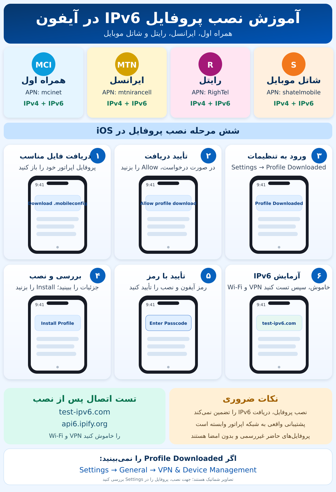

# آموزش تصویری نصب پروفایل IPv4 + IPv6 در آیفون

این راهنما برای چهار APN زیر است: **همراه اول = `mcinet`، ایرانسل = `mtnirancell`، رایتل = `RighTel`، شاتل موبایل = `shatelmobile`**.

## ۱. پیش از نصب
- از فعال‌بودن سرویس اینترنت سیم‌کارت اطمینان بگیرید و هنگام استفاده از دو سیم‌کارت خط دیتای درست را در **Settings → Cellular → Cellular Data** انتخاب کنید.
- تنها پروفایل مربوط به اپراتور خود را دریافت کنید. فایل‌های این پروژه غیررسمی و بدون امضای دیجیتال هستند؛ قبل از نصب **View Details / More Details** را بررسی کنید.
- در صورت داشتن پروفایل APN مشابه، قبل از تغییر آن نسخه قبلی را بررسی کنید؛ اگر حذف می‌کنید بدانید ممکن است تنظیمات APN قبلی برگردد.

## ۲. دانلود و نصب
1. فایل `.mobileconfig` مربوط به سیم‌کارت را از یک لینک HTTPS در Safari یا پیوست Apple Mail دریافت کنید.
2. اگر درخواست **Allow** ظاهر شد، آن را تأیید کنید.
3. **Settings → Profile Downloaded** را باز کنید؛ اگر وجود نداشت، **Settings → General → VPN & Device Management** را بررسی کنید.
4. نام، ناشر/امضا و محتوای پروفایل را بررسی کنید و **Install** را انتخاب کنید.
5. رمز آیفون را وارد کرده و نصب را تأیید کنید.

**نکته:** دانلود از GitHub Raw ممکن است فایل را فقط ذخیره کند. دریافت فایل ZIP به معنای نصب نیست؛ ابتدا فایل `.mobileconfig` را استخراج و باز کنید. Safari الزامی نیست، اما از مسیرهای قابل‌اعتماد Apple برای دریافت پروفایل است.

طبق Apple، فقط یک پروفایل می‌تواند هم‌زمان منتظر نصب باشد و پروفایل نصب‌نشده پس از **۸ دقیقه** از فهرست دانلودشده پاک می‌شود. در صورت فعال‌بودن Stolen Device Protection، ممکن است محدودیت نصب خارج از مکان آشنا وجود داشته باشد. ویژگی امنیتی را صرفاً برای نصب یک پروفایل غیررسمی بدون بررسی خطرات آن غیرفعال نکنید.

## ۳. تست واقعی IPv6
1. **Wi-Fi** و **VPN** را خاموش کنید تا اتصال سیم‌کارت مستقیماً آزمایش شود.
2. در صورت نیاز Cellular Data را یک بار خاموش و روشن کنید.
3. [test-ipv6.com](https://test-ipv6.com/) را باز کنید و نتیجه IPv4/IPv6 را مشاهده کنید.
4. برای مشاهده آدرس **IPv6** از [api6.ipify.org](https://api6.ipify.org/) و برای **IPv4** از [api4.ipify.org](https://api4.ipify.org/) استفاده کنید.
5. تست پیش و پس از نصب را با همان سیم‌کارت و شرایط مشابه مقایسه کنید.

**مهم:** پروفایل فقط IPv4 و IPv6 را مجاز می‌کند؛ شبکه می‌تواند تنها IPv4 ارائه کند. نتیجه موفق نصب هم اثبات تخصیص IPv6 نیست. دسترسی IPv6 از داخل گوشی به معنای امکان اتصال ورودی از اینترنت نیست.

## ۴. رفع مشکل و حذف
- اگر گزینه **Profile Downloaded** نیست، پروفایل را دوباره دانلود کنید.
- اگر نصب ناموفق بود، تنظیمات اپراتور یا نسخه iOS ممکن است مانع اعمال پروفایل سفارشی شوند؛ از مسیر تنظیم APN رسمی اپراتور استفاده کنید.
- اگر اینترنت مختل شد: **Settings → General → VPN & Device Management → [Profile] → Remove Profile**؛ سپس دیتای گوشی را دوباره روشن کنید. در صورت ادامه مشکل تنظیمات اپراتور را دوباره از منبع رسمی دریافت کنید.
- تنظیمات شبکه را فقط به‌عنوان آخرین راه و با آگاهی از اثرات آن بر Wi-Fi و VPN ریست کنید.

## مستندات
- Apple: https://support.apple.com/en-us/102400
- Apple: https://developer.apple.com/documentation/devicemanagement/cellular
- Apple: https://developer.apple.com/documentation/devicemanagement/cellular/apnsitem
- همراه اول: https://mci.ir/internet-settings
- ایرانسل: https://irancell.ir/p/292429
- رایتل: https://www.rightel.ir/en/p/1516/ipv6-settings-help
- شاتل موبایل: https://shatelmobile.ir/setting/راهنمای-ios/

**محدودیت:** فایل‌ها و راهنما مطابق مستندات بازبینی شده‌اند، اما نصب عملی روی آیفون/سیم‌کارت و پشتیبانی IPv6 شاتل موبایل را تأیید نکرده‌ایم.
